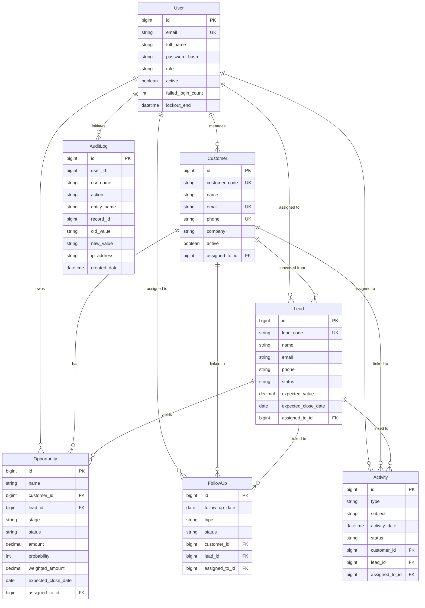

# AcxiomCRM - Enterprise Customer Relationship Management System

AcxiomCRM is an enterprise-grade customer relationship management solution developed on Spring Boot 3.3, Java 17, and MySQL 8. It incorporates role-based security, multi-tier data scoping, lead qualification workflows, opportunity pipeline management, audit trail tracking, automated background scheduling, and RESTful APIs with JWT authentication.

---

## 1. Technology Stack

- **Core Framework:** Spring Boot 3.3.5 / Java 17
- **Security & Identity:** Spring Security 6, BCrypt Password Encoders, Custom Lockout Handler, CSRF Protection
- **Persistence & ORM:** Spring Data JPA, Hibernate, MySQL Connector/J 8.0, HikariCP, H2 (for isolated test execution)
- **Web & Templating:** Spring MVC, Thymeleaf, Thymeleaf Extras Spring Security 6, Bootstrap 5.3, Bootstrap Icons
- **Data Visualizations:** Chart.js
- **REST & Security Tokens:** JJWT (Java JWT) 0.12.6, Bucket4j 8.10.1 (Rate Limiting), Springdoc OpenAPI 2.6.0 (Swagger UI)
- **Quality & Testing:** JUnit 5, Mockito, Spring Test / MockMvc

---

## 2. Default Credentials & Roles

The system automatically initializes an idempotent database seed upon boot (`DataSeeder.java`):

| Role | Username | Password | Access Scope |
| :--- | :--- | :--- | :--- |
| **ROLE_ADMIN** | `admin@acxiomcrm.com` | `Admin@123` | Global System Access, User Management, Full Audit Logs |
| **ROLE_MANAGER** | `manager@acxiomcrm.com` | `Manager@123` | Team & Subordinate Records, All Reports, User List (Read-only) |
| **ROLE_SALES_EXECUTIVE** | `sales1@acxiomcrm.com` | `Sales@123` | Assigned Records Only |
| **ROLE_SALES_EXECUTIVE** | `sales2@acxiomcrm.com` | `Sales@123` | Assigned Records Only |

---

## 3. Architecture & Package Structure

The codebase is organized into cleanly decoupled layers under `com.acxiom.crm`:

```
com.acxiom.crm
├── config/             # Spring Security, Web MVC, OpenAPI, Scheduler, Async configurations
├── controller/         # MVC Controllers returning Thymeleaf HTML views
│   └── api/            # REST API Controllers (@RestController) returning JSON DTOs
├── dto/                # Request & response data transfer objects for REST APIs
├── entity/             # JPA entity definitions and database mappings
├── enums/              # Core business enumerations (Role, LeadStatus, OpportunityStage, etc.)
├── exception/          # Custom exceptions and @ControllerAdvice GlobalExceptionHandler
├── repository/         # Spring Data JPA repositories with derived and JPQL queries
├── security/           # CrmUserDetailsService, JwtTokenProvider, JwtFilter, ScopeHelper, Lockout
├── service/            # Business service interfaces
│   └── impl/           # Concrete service implementations containing all business rules
├── util/               # Audit helpers and CSV generation utilities
├── validation/         # Custom Bean Validation annotations (@StrongPassword, @IndianPhone)
└── viewmodel/          # Form-backing objects for MVC views with validation constraints
```

---

## 4. ASP.NET Core to Spring Boot Architecture Mapping

Per Section 17 specifications, the equivalent enterprise Spring stack was implemented in place of ASP.NET Core components:

| ASP.NET Core Concept | Spring Boot Equivalent | Implementation Details in AcxiomCRM |
| :--- | :--- | :--- |
| **ASP.NET Core Identity** | Spring Security 6 + `UserDetailsService` | `CrmUserDetailsService`, `CrmUserPrincipal`, BCrypt password hashing. |
| **Identity Lockout** | Custom Lockout Management | `LoginEventHandler` tracks 5 failed attempts, sets 15-minute lockout; `UserService.unlockAccount` provides admin unlock. |
| **Password Validation** | Custom Bean Validation | `@StrongPassword` validator enforcing min 8 characters, upper, lower, digit, and special symbol. |
| **Entity Framework Core** | Spring Data JPA + Hibernate | Repositories extend `JpaRepository` and `JpaSpecificationExecutor`; schema annotations provide DB constraints. |
| **Razor Views & Tag Helpers** | Thymeleaf + Spring Security Extras | Thymeleaf templates in `src/main/resources/templates` with `th:text`, `th:field`, `sec:authorize`. |
| **[ValidateAntiForgeryToken]** | Spring Security CSRF Protection | Enabled on all state-changing endpoints; automatic token inclusion via `th:action`. |
| **IAuthorizationService / Scope** | `ScopeHelper` & Service Validation | `ScopeHelper` computes user scope (Admin/Manager = all, Sales = self); service methods enforce IDOR access barriers. |
| **ASP.NET Web API Controllers** | Spring MVC `@RestController` | Dedicated `/api/**` controllers returning strict DTOs and RFC 7807 `ProblemDetail` errors. |
| **Bearer Authentication** | JJWT Filter Chain | Stateless `JwtAuthenticationFilter` with Bearer token header extraction and validation. |

---

## 5. Minimum Evaluation Criteria Compliance (Section 17.17)

| Feature Requirement | Status | Implementing Components |
| :--- | :--- | :--- |
| **Authentication & Authorization** | Verified | `SecurityConfig`, `CrmUserDetailsService`, `LoginEventHandler`, `AuthController` |
| **Account Lockout & Password Rules** | Verified | `LoginEventHandler`, `StrongPasswordValidator`, `UserServiceImpl`, `auth/locked-account.html` |
| **Data Scope & IDOR Protection** | Verified | `ScopeHelper`, `CustomerServiceImpl`, `LeadServiceImpl`, `OpportunityServiceImpl`, `FollowUpServiceImpl` |
| **Role-based Analytics Dashboard** | Verified | `DashboardController`, `DashboardServiceImpl`, `dashboard/index.html`, Chart.js endpoints |
| **Customer Deduplication** | Verified | `CustomerServiceImpl.createCustomer`, `CustomerRepository`, `customer/form.html` |
| **Lead Status State Machine** | Verified | `LeadServiceImpl.changeStatus`, `InvalidLeadStatusTransitionException`, `lead/detail.html` |
| **Automated Lead Conversion** | Verified | `LeadServiceImpl.convertLead` (creates Customer + Opportunity in `QUALIFICATION` stage) |
| **Opportunity Financial Rules** | Verified | `OpportunityServiceImpl`, Amount > 0 check, Probability 0-100 check, Expected Close Date check |
| **Pipeline Visual Kanban** | Verified | `OpportunityController.pipelineView`, `opportunity/pipeline.html` |
| **Follow-up Lifecycle & Overdue Cron**| Verified | `FollowUpServiceImpl`, `FollowUpScheduler` (@Scheduled daily runner for `MISSED` transition) |
| **Activity Tracking** | Verified | `ActivityServiceImpl`, `ActivityController`, `activity/list.html` |
| **Reporting & CSV Exporters** | Verified | `ReportServiceImpl`, `ReportController`, `report/*.html` (8 report categories with CSV export) |
| **Append-Only Audit Trail** | Verified | `AuditLogServiceImpl`, `AuditAspect`, `audit/list.html` (no update/delete path) |
| **REST API with JWT & Rate Limit** | Verified | `AuthApiController`, `RateLimitFilter`, `JwtTokenProvider`, Swagger UI at `/swagger-ui/index.html` |
| **Comprehensive Test Suite** | Verified | `OpportunityRulesTest`, `FollowUpRulesTest`, `LeadWorkflowTest`, `LeadConversionTest`, `CustomerDuplicateTest`, `LockoutTest`, `ScopeFilterTest` |

---

## 6. Assumptions & Engineering Decisions

1. **Test Environment Independence:** Tests utilize an in-memory H2 database configured in MySQL compatibility mode (`src/test/resources/application.properties`), enabling clean execution of `mvn test` without requiring an active external MySQL server during CI/CD.
2. **Sequential Entity Codes:** Customer codes (`CUST-0001`) and Lead codes (`LEAD-0001`) are sequentially generated using max database sequences within transaction boundaries.
3. **Audit Log Retention:** Audit log records are strictly append-only. The entity columns are flagged with `updatable = false` and no update or delete repository methods or UI triggers exist.
4. **Rate Limiting Threshold:** The `/api/auth/login` endpoint is rate-limited using a Bucket4j token bucket configured to allow 10 requests per minute per client IP.

---

## 7. Build and Run Instructions

### Prerequisites
- JDK 17 or higher
- Maven 3.8+
- MySQL 8.0+ (for standard application runtime)

### Running with MySQL
1. Configure credentials in `src/main/resources/application-local.properties` (or set environment variables `DB_USER` and `DB_PASSWORD`):
   ```properties
   spring.datasource.url=jdbc:mysql://localhost:3306/acxiomcrm_db?createDatabaseIfNotExist=true&useSSL=false&serverTimezone=UTC&allowPublicKeyRetrieval=true
   spring.datasource.username=root
   spring.datasource.password=rootpassword
   app.jwt.secret=YourSuperSecretKeyWithAtLeast256BitsLengthForHs512SignaturesHere
   ```
2. Build and run:
   ```bash
   mvn clean spring-boot:run
   ```
3. Access web interface: `http://localhost:8080`
4. Access Swagger documentation: `http://localhost:8080/swagger-ui/index.html`

### Executing the Test Suite
Run the full test suite via Maven:
```bash
mvn clean test
```

---

## 8. REST API Reference

| Method | Endpoint | Description | Access Role |
| :--- | :--- | :--- | :--- |
| `POST` | `/api/auth/login` | Authenticate and obtain JWT token | Anonymous (Rate-limited) |
| `POST` | `/api/auth/logout` | Invalidate session / record logout audit | Authenticated |
| `GET` | `/api/customers` | Search & paginate customers (scoped) | Authenticated |
| `GET` | `/api/customers/{id}` | Retrieve customer detail (scoped) | Authenticated |
| `POST` | `/api/customers` | Create new customer | Authenticated |
| `PUT` | `/api/customers/{id}` | Update existing customer (scoped) | Authenticated |
| `DELETE`| `/api/customers/{id}`| Deactivate customer (scoped) | Authenticated |
| `GET` | `/api/leads` | Search & paginate leads (scoped) | Authenticated |
| `POST` | `/api/leads` | Create new lead | Authenticated |
| `GET` | `/api/opportunities` | Search & paginate opportunities (scoped)| Authenticated |
| `POST` | `/api/opportunities` | Create opportunity | Authenticated |
| `GET` | `/api/followups` | Search & paginate follow-ups (scoped) | Authenticated |
| `POST` | `/api/followups` | Schedule new follow-up | Authenticated |
| `GET` | `/api/reports/pipeline` | Retrieve pipeline summary report | Manager, Admin |

---

## 9. Entity-Relationship (ER) Diagram


